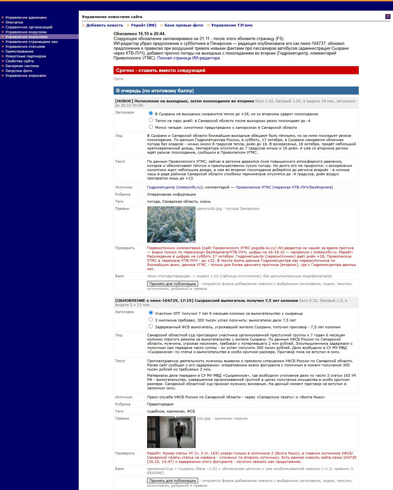
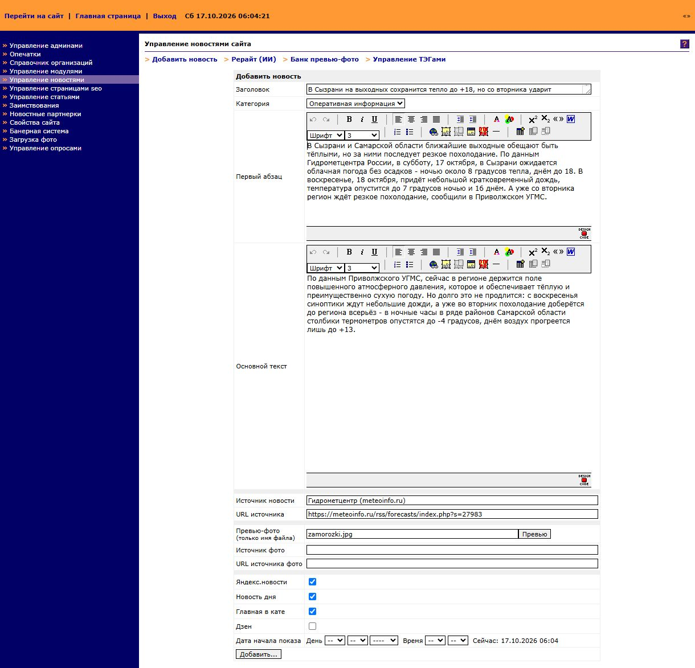
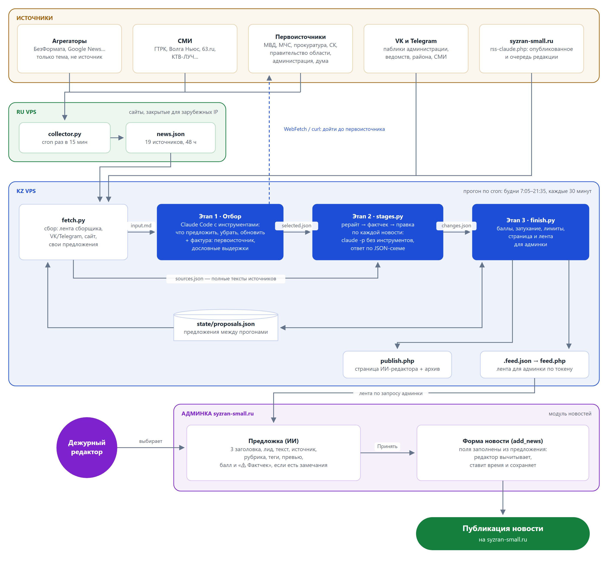
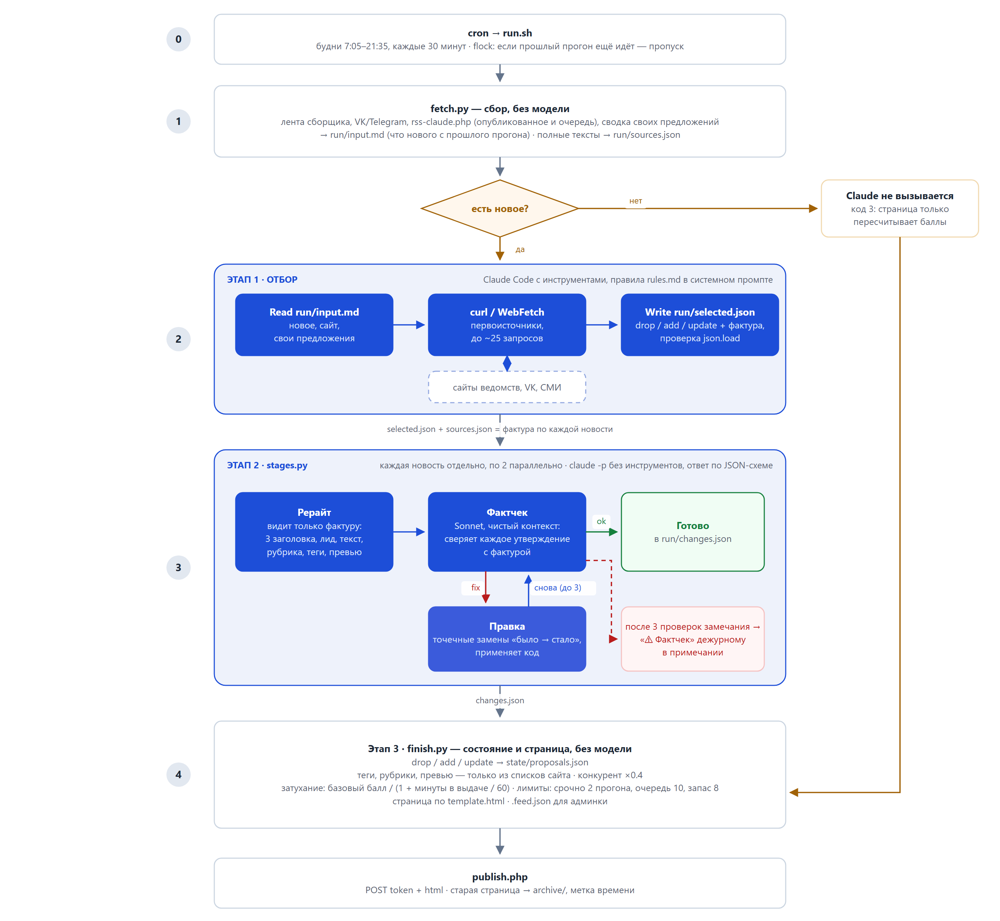
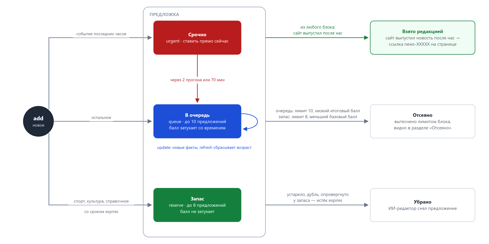
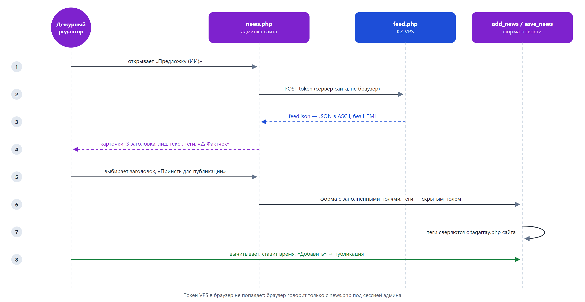
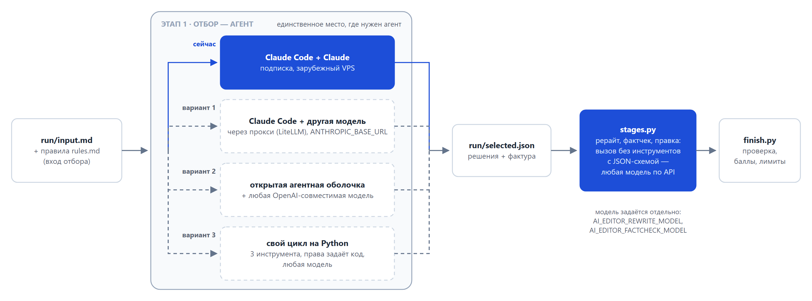

# ИИ-редактор

«Младший редактор» для городского новостного сайта [syzran-small.ru](https://www.syzran-small.ru) (Сызрань). ИИ-агент берет на себя рутинную задачу журналиста — регулярная проверка открытого списка источников: местная администрация, сайты госструктур, сайты конкурентов, текущая выдача Яндекс/Гугл Новостей. Каждые полчаса ИИ-агент читает первоисточники, СМИ и соцсети, отбирает новости про Сызрань, сверяет их с тем, что сайт уже выпустил или поставил в очередь, доходит до первоисточника, пишет три варианта заголовка, лид и текст, ставит рубрику, теги и превью. Также агент строит «рейтинг важности» новостей по заданным коэффициентам категории и источника, с затуханием по времени. Отдельный ИИ-фактчекер сверяет каждый текст с первоисточником, ошибки исправляются точечно. В итоге ранжированный список готовых на 90% к публикации новостей попадает в «Предложку» в админке сайта. Выпускающему редактору остается только нажать «Принять для публикации» и заполнить время выхода в форме добавления новости.

Полная лента предложений (обновляется по будням каждые 30 минут, 7:05–21:35 по Самаре): **http://109.248.18.201:8808/ai-editor/**

<table>
  <tr>
    <th>Предложка (ИИ) в админке</th>
    <th>«Принять для публикации» → форма новости</th>
  </tr>
  <tr>
    <td valign="top"></td>
    <td valign="top"></td>    
  </tr>
</table>

## Стек

| Слой | Чем сделано |
|---|---|
| Агент-редактор (отбор) | [Claude Code](https://docs.anthropic.com/en/docs/claude-code) в headless-режиме (`claude -p`) по подписке (`CLAUDE_CODE_OAUTH_TOKEN`), инструменты Read/Edit/Write/Bash/WebFetch/WebSearch под белым списком |
| Рерайт, фактчек, правка | отдельные вызовы `claude -p` без инструментов, ответ строго по JSON-схеме (`--json-schema`); фактчекер — Sonnet |
| Правила редакции | Markdown в системном промпте: `rules.md` (правила отбора, справочник первоисточников, баллы) — для отбора; `rewrite_rules.md` + `tags.md`, `cats.md`, `fotos.md` (стиль, теги, рубрики и банк превью сайта) — для рерайта; `factcheck_rules.md`, `fix_rules.md` — для проверки и правки |
| Сбор новостей | Python stdlib: сборщик на российском VPS (19 RSS/HTML-источников) + `social.py` на KZ VPS (VK API `wall.get` и веб-превью Telegram, 15 пабликов) + лента сайта |
| Логика вокруг модели | Python: `fetch.py` (вход и полные тексты источников), `stages.py` (рерайт → фактчек → правка по каждой новости), `finish.py` (состояние, баллы, лимиты, страница, лента для админки) |
| Хостинг | VPS в Казахстане (1 CPU, 2 ГБ, Ubuntu 22.04): cron, nginx, php-fpm |
| Интеграция с сайтом | PHP-блоки в модуле новостей админки (CMS SmallNuke, windows-1251) + `feed.php` на VPS |
| Связующее звено | `state/proposals.json` (предложения между прогонами), `run/selected.json` (решения отбора и фактура), `run/changes.json` (готовые тексты), `.feed.json` (лента для админки) |

## Почему без скиллов и субагентов

В Claude Code есть **скиллы** — пакеты инструкций, которые модель подгружает по требованию, — и **субагенты** — отдельные агенты со своим контекстом, которых вызывает главный агент. Мы рассмотрели оба варианта и сознательно их не используем: ИИ-редактор работает без человека, по cron, в headless-режиме (`claude -p`), и здесь они не дают выигрыша, только добавляют шаги.

1. **Правила нужны в каждом прогоне.** Скилл выгоден, когда инструкции нужны изредка: до вызова в контексте висит только его описание. Правила редакции, справочник первоисточников, теги и рубрики нужны всегда, так что экономить нечего, а загрузка скилла — это лишний шаг агента на каждом прогоне.
2. **Кэш промпта.** Правила лежат в системном промпте и образуют неизменный префикс, который кэшируется между прогонами: кэш живёт час, прогоны идут каждые 30 минут. Скилл подгружается в середине диалога, уже после меняющегося входа, поэтому из кэша между прогонами он не читается.
3. **Порядок шагов определяет код, а не модель.** Прогон — конвейер с фиксированным порядком: сбор → отбор → рерайт → проверка фактов → страница. Когда этапы вызывает Python, у каждого есть таймаут и ограничение на параллельность, сбой одной новости не роняет прогон, каждый ответ модели проверяется по JSON-схеме. Субагент добавил бы ещё один слой решений главного агента: вызовет ли он субагента и что ему передаст.
4. **Чистый контекст получается и без субагента.** Главная польза субагента — независимый взгляд: фактчекер не видит рассуждений автора текста. Отдельный вызов `claude -p` из кода даёт то же самое — фактчекер получает только фактуру и готовый текст. К тому же фактура ровно та, что видел рерайтер: код передаёт её сам, и проверяющему не нужно ничего скачивать заново, а часть источников с зарубежного VPS всё равно недоступна.
5. **Вызовы без инструментов дешевле и быстрее.** Рерайт, проверка фактов и точечная правка — это один ответ модели по JSON-схеме, без инструментов и без системного промпта Claude Code. Агентный цикл с инструментами нужен только этапу отбора, где модель ходит по первоисточникам.
6. **Переиспользование — через файлы.** Одни и те же правила (markdown-файлы) подключаются как системный промпт во всех местах, где нужны. Чтобы использовать их повторно, оборачивать их в скилл не нужно.

Где скиллы были бы уместны — в интерактивной работе разработчика в Claude Code. Например, сказать «перепиши эту новость по правилам редакции» и получить нужные правила по требованию. Такой скилл можно добавить, не трогая конвейер: он будет ссылаться на те же файлы правил.

Один такой скилл в проекте есть — **недельный отчёт** ([`.claude/skills/weekly-report/`](.claude/skills/weekly-report/SKILL.md)). Его запускают раз в неделю в сессии фразой «сделай отчёт за неделю», и здесь скилл как раз к месту: нужен изредка, а работа делится пополам. Скрипты скачивают с VPS архив страниц и логи, считают все цифры (`stats.json`) и рисуют слайды. Claude пишет только слова — заголовки, пояснения, выводы — по этим цифрам. Пока в текстах остаются пометки TODO, PDF не собирается; каждый слайд скилл сохраняет картинкой, чтобы проверить вёрстку. Сравнение с прошлой неделей строится само по сохранённым `docs/stats_*.json`. Пример результата — [`docs/ai_editor_week_2026-10-12_10-16.pdf`](docs/ai_editor_week_2026-10-12_10-16.pdf).

## Архитектура

Проект живёт на трёх серверах:

| Сервер | Роль |
|---|---|
| Хостинг [SpaceWeb (sweb)](https://sweb.ru) | сам новостной сайт syzran-small.ru: CMS, админка с ИИ-блоками, лента `rss-claude.php` |
| Зарубежный VPS (Казахстан) | прогоны агента: Claude Code, `fetch.py` / `finish.py`, страница ИИ-редактора, лента для админки. Зарубежный — потому что Anthropic недоступен с российских IP |
| Российский VPS | сканирование источников: `collector.py` обходит сайты, закрытые для зарубежных IP (правительство области, минтранс, СК, ГТРК), и отдаёт агенту одну JSON-ленту |



Как и в [«Городе Н»](https://github.com/delffine/gorod-n), работа поделена так: **детерминированное делает Python, решения принимает модель.** Скрипты скачивают ленты, считают, что нового с прошлого прогона, ведут состояние, пересчитывают баллы, вытесняют лишнее, собирают страницу и публикуют её. Модель читает новое, сверяет факты с сайтом, ищет первоисточник, решает, что предложить, что убрать и что обновить, пишет тексты и проверяет их. Модель не видит токенов и не может ничего опубликовать: агент отбора пишет только файл `run/selected.json`, а рерайт, фактчек и правка возвращают JSON по схеме, который разбирает и применяет код.

С 16.10.2026 прогон разделён на **три этапа** — вместо одного агента, который и отбирал, и писал:

1. **Отбор** — агент с инструментами: что предложить, убрать, обновить, и **фактура** по каждой новости (первоисточник первым, дословные выдержки).
2. **Рерайт → фактчек → правка** — для каждой новости отдельные вызовы без инструментов. Рерайтер видит только фактуру. Фактчекер — другой вызов с чистым контекстом: только фактура и готовый текст.
3. **Состояние и страница** — Python.

Зачем: в одном агенте текст никто не перепроверял, и выдумки («туи утеплили», когда в источнике — полив и удобрение; «ограждения установлены» вместо «устанавливаются»; «почти вдвое» при 109 → 64) доходили до редактора. На одних и тех же входах прошлая схема давала замечания фактчекера почти в каждом тексте.

## Прогон по шагам



### 0. cron и `run.sh`

Прогоны идут по будням с 7:05 до 21:35, каждые 30 минут (`5,35 7-21 * * 1-5`), в часы работы редакции. `run.sh`:

- держит `flock`, чтобы два прогона не шли параллельно;
- подгружает `~/.config/ai-editor.env` (токен подписки Claude, адрес ленты сборщика);
- запускает отбор: `claude -p "$(cat select.md)"` с `--append-system-prompt "$(cat rules.md)"`. Правила лежат в системном промпте, а не в файле для чтения: неизменный префикс кэшируется между прогонами, и модель не тратит ходы на его чтение;
- `--tools` оставляет только нужные инструменты, `--permission-mode dontAsk` и `--allowedTools` ограничивают права: читать можно только `~/ai-editor/**`, писать — только `run/selected.json`, в Bash разрешены `curl`, `python3`, `grep`, `head`, `echo`;
- если `selected.json` появился — запускает `stages.py` (рерайт и фактчек), потом `finish.py`;
- `timeout -s KILL 900`, `< /dev/null`, `--output-format json`. Число ходов, длительность и стоимость каждого этапа и вердикты фактчекера пишутся в дневной лог.

### 1. Вход — `fetch.py`

Обычный Python, без модели. Собирает `run/input.md`:

- **лента сборщика** с RU VPS: всё про Сызрань, засечённое после прошлого успешного чтения (у ленты своя отметка `feed_last`, поэтому новости, пришедшие во время сбоя, разбираются потом);
- **VK и Telegram** (`social.py`): новые посты 15 пабликов — администрация, ведомства, район, СМИ — за сутки. VK читается через API `wall.get`, Telegram — через публичное веб-превью `t.me/s/…`. У городских пабликов берётся всё, у областных — только посты со словом «Сызрань». Что уже видели, помнит `state/social_seen.json`; отметка сдвигается только после успешного прогона;
- **сайт** через `rss-claude.php`: 40 последних новостей с пометками `НОВОЕ` (id больше, чем в прошлый прогон) и `ПЛАН` (дата в будущем, то есть очередь редакции). Лиды даются только за последние 12 часов;
- **компактная сводка своих предложений**: id, блок, возраст, заголовок, начало лида. Полный `proposals.json` модель читает точечно и только тогда, когда обновляет предложение.

Во входе тексты обрезаны, а полные тексты всех новых материалов `fetch.py` кладёт в `run/sources.json` (url → источник, заголовок, дата, текст). Оттуда их берёт `stages.py`: агенту отбора достаточно сослаться на url, переписывать текст не нужно.

Если нового нет ни в источниках, ни на сайте, `fetch.py` выходит с кодом 3 и Claude не вызывается: страница просто пересчитывает баллы. Если сборщик недоступен, прогон идёт по сайту и VK/TG, а на странице появляется предупреждение.

### 2. Отбор — Claude Code

Модель получает правила редакции в системном промпте и задание из `select.md`:

1. **Первоисточник, а не перепечатка.** Агрегаторы дают только тему. По справочнику ведомств (полиция → ГУ МВД, пожары → МЧС, город → администрация…) модель доходит до первоисточника и ссылается на него. Если первоисточник не найден, она так и пишет в `note`.
2. **Дубликат сверяется по фактам, а не по теме.** Отключения воды, ДТП и погода повторяются каждый день, поэтому сравниваются даты, адреса и время.
3. **У происшествия есть цепочка обновлений.** Если появились новые факты к уже вышедшей новости, это не дубль: модель пишет предложение-обновление со ссылкой на `news-XXXXX`.
4. **Город издания не равен месту события.** Сызранское СМИ часто перепечатывает чужие новости.
5. **Прямой конкурент понижается**, областные, федеральные и официальные источники повышаются.

По каждой новости модель выбирает блок (`urgent` / `queue` / `reserve`) и ставит базовый балл по таблицам из анализа 5000 новостей сайта (какие темы и источники читают; таблицы — в `rules.md`). Ответ — `run/selected.json` с операциями `drop` / `add` / `update` / `skipped`. Если сайт выпустил новость после нашего предложения, предложение снимается с пометкой «взято» и ссылкой на новость сайта.

Тексты отбор не пишет. Его главная работа — **фактура** (`sources`) для следующего этапа, который ничего не может досмотреть сам:

- первоисточник первым, дальше пересказы с новыми фактами (для происшествия — вся цепочка);
- `name` — кто стоит за источником («администрация Сызрани (VK «Город Сызрань»)», а не просто название паблика): по нему рерайтер пишет «сообщает…», а фактчекер проверяет, кто сообщил;
- для материалов из входа — только `url`, текст подставит код; для того, что агент скачал сам, — **дословные выдержки**: кто, что, где, когда, цифры, цитаты;
- в материале только заголовок (пост-картинка, анонс) и текст добыть не удалось — новость пропускается с причиной «нет фактуры»: из одного заголовка новость не пишется.

### 3. Рерайт и фактчек — `stages.py`

Для каждой добавленной или обновлённой новости — цепочка коротких вызовов `claude -p` **без инструментов**, с ответом строго по JSON-схеме (`--json-schema`). Новости идут параллельно по две (на 1 CPU больше не стоит), первая — одна: её вызовы прогревают кэш системных промптов, остальные читают из кэша.

1. **Рерайт.** Системный промпт — `rewrite_rules.md` (стиль редакции, «факты неприкосновенны»), `cats.md`, `tags.md`, `fotos.md`. На входе только фактура. Ответ: 3 варианта заголовка, лид, текст, примечание редактору, рубрика, до 3 тегов, превью.
2. **Фактчек** (Sonnet, `factcheck_rules.md`). Отдельный вызов с чистым контекстом: видит только фактуру и готовый текст, не видит рассуждений рерайтера. Сверяет каждое утверждение с фактурой, а не со своей памятью: факт, цитата, время, место, источник. Ответ: `ok` / `fix` / `stop` и список замечаний (цитата из текста, что в материале, как исправить).
3. **Правка** (`fix_rules.md`) — при `fix`. Правщик возвращает не новый текст, а **точечные замены** «было → стало», применяет их код. Остальной текст не меняется, поэтому правка не вносит новых ошибок в другие места: при «перепиши с учётом замечаний» модель исправляла одно и выдумывала другое. Потом снова фактчек — всего до 3 проверок.
4. Если замечания остались только к одному из вариантов заголовка — этот вариант выбрасывается. Остальные замечания уходят дежурному в примечание «⚠ Фактчек» с цитатой и тем, что сказано в источнике.

Все кавычки в ответах код приводит к «ёлочкам». Фактура сохраняется в предложении (`material`): при обновлении новости рерайтер и фактчекер видят и прежний материал, и новый. Если рерайт сорвался, предложение всё равно показывается с пометкой. Сбой одной новости не роняет прогон.

### 4. Состояние и страница — `finish.py`

Обычный Python. Модель не правит состояние напрямую: каждую её операцию применяет и проверяет код.

- **Битый JSON** (самый частый сбой — прямая кавычка внутри текста) чинится автоматически: экранируется кавычка, на которой споткнулся разбор.
- **Теги, рубрики и превью** проходят только из списков сайта (`tags.md`, `cats.md`, `fotos.md`), остальное выбрасывается.
- **Конкурент как главный источник**: базовый балл ×0.4, и такое предложение не попадает в «Срочно».
- **Затухание**: итоговый балл = базовый / (1 + минуты в выдаче / 60). Не взятое редакцией за пару прогонов опускается вниз, и свежее поднимается само. Запас не затухает.
- **Лимиты**: «Срочно» держится не дольше 2 прогонов или 70 минут, потом уходит в очередь. В очереди до 10 предложений, лишние вытесняются по итоговому баллу. В запасе до 8, вытесняются предложения с меньшим базовым баллом. Всё вытесненное видно в разделе «Отсеяно».
- **Страница** собирается по `template.html` и уходит POST-запросом в `publish.php`. Токен публикации лежит в отдельном файле, который Claude не видит. `publish.php` переносит прошлую версию в `archive/` и сам ставит метку времени.
- **Лента для админки** `.feed.json` содержит только текст, без HTML: метки и примечания идут текстом, источники — списком `{t, url}`. В ленте есть и время следующего обновления.
- Если прогон не удался, отметка `last_run` не сдвигается, и пропущенное разберёт следующий прогон.

## Жизненный цикл предложения



## Интеграция с админкой сайта

Сайт работает на старой PHP-CMS (SmallNuke, windows-1251, без `mbstring`). Модуль новостей в репозиторий целиком не выложен, здесь только встроенные в него ИИ-блоки:

| Файл | Что это |
|---|---|
| `server/admin/news_ai_feed.php` | `ai_feed()` — страница «Предложка (ИИ)»: забирает ленту с VPS, карточки рисует JS из текстовых полей (HTML с VPS не принимается); «Принять для публикации» отправляет выбранный вариант в форму `add_news` |
| `server/admin/news_ai_common.php` | `ai_call()` — запрос к VPS с токеном, `ai_prefill()` — предзаполнение формы `add_news` (заголовок, лид, текст, источник, рубрика, превью), `ai_feed_keywords()` — теги только из `tagarray.php` сайта, журнал `log/aiedit…` (что из предложенного приняли) |
| `server/admin/patch_news.py` | встраивает оба блока в исходный `news.php`: функции перед `switch($in)`, `case "ai_feed"`, ссылку в меню модуля, предзаполнение полей `add_news` и `save_news`. Проверяет число вхождений каждой правки и обратимость cp1251 |
| `server/admin/feed.php` | на VPS: отдаёт `.feed.json` по токену |
| `server/claude-rss.php` | на сайте: лента для агента — полный текст, просмотры, источник, рубрика, теги, превью и **запланированные** новости (очередь редакции) |



Токен VPS в браузер не попадает: браузер общается только с `news.php` под сессией админа, на VPS ходит сервер сайта. Ответ VPS — JSON в чистом ASCII, поэтому перекодировать cp1251 ↔ UTF-8 не нужно. Время следующего обновления берётся из ленты, и страница подсказывает редактору, когда её обновить.

## Сборщик на RU VPS

Часть первоисточников (правительство области, минтранс, СК, ГТРК) не открывается с зарубежного IP. Поэтому сбор вынесен на второй VPS с российским IP. `collector/collector.py` — один файл на стандартной библиотеке Python 3.8+, его можно поставить на любой сервер без pip и venv:

- cron раз в 15 минут обходит 19 источников (RSS и списки ссылок со страниц) и кладёт всё свежее за 48 часов в один JSON, который отдаёт nginx;
- у каждой записи есть поля `published_at`, `detected_at`, `source`, `kind` (`primary` / `media` / `aggregator`), `title`, `text`, `url`, `syzran`. Для сызранских новостей полный текст дотягивается со страницы;
- `--probe` проверяет доступность закрытых сайтов и ищет на них RSS.

## Надёжность и безопасность

| Риск | Что сделано |
|---|---|
| Модель публикует что-то сама | на сайт автопубликации нет; агент отбора пишет только `run/selected.json`, остальные вызовы — без инструментов, токен публикации скрыт от всех |
| Опасная команда агента | `--tools` + `--allowedTools` + `dontAsk`: чтение только в каталоге проекта, запись в один файл, Bash — 5 команд; у рерайта и фактчека инструментов нет вовсе (`--tools ""`) |
| Выдуманные факты в тексте | рерайтер видит только фактуру; отдельный фактчекер с чистым контекстом сверяет каждое утверждение; правка — точечными заменами, без переписывания; неснятые замечания — дежурному в «⚠ Фактчек» |
| Ответ модели не того формата | рерайт, фактчек и правка отвечают строго по JSON-схеме (`--json-schema`) |
| Выдуманные теги, рубрики, превью | `finish.py` пропускает только значения из списков сайта |
| Битый JSON от модели | автопочинка в `finish.py`: экранирование кавычки, на которой споткнулся разбор |
| Сбой Claude (лимит подписки, таймаут) | страница всё равно публикуется с предупреждением и прошлыми предложениями; `last_run` не сдвигается |
| Сборщик недоступен | прогон идёт по сайту и VK/TG, на странице предупреждение; своя отметка `feed_last` |
| Пустые прогоны тратят подписку | нового нет → Claude не вызывается (код 3) |
| Предложка зарастает | затухание балла, лимиты блоков, `expires` у запаса |
| Зависание | `timeout -s KILL 900`, `flock` |
| Чужой доступ к ленте | `feed.php` отдаёт ленту только по токену, Предложка в админке — только вошедшему админу |
| Служебные файлы на VPS | `.feed.json` и архивы — с точкой в имени, nginx их не отдаёт; PHP исполняется только для `publish.php` и `feed.php` |
| Секреты | в репозитории `CHANGE_ME` и шаблон `.env.example`; на VPS — файлы с правами 600; токены публикации и VK — в отдельных файлах, которые читает только код, в окружение Claude они не попадают |

## Цифры

- 30 прогонов в рабочий день; отбор — 4–20 ходов модели, 1–6 минут. Первый прогон утром (за всю ночь) — самый долгий.
- Рерайт + фактчек: ~1 минута и ~$0.09 на новость; в прогоне обычно 0–2 новые новости, иногда до 4.
- Оценка расхода по `total_cost_usd` Claude Code (`cost.sh`): отбор $0.12–0.6 за прогон, утренний до ~$0.9; с рерайтом и фактчеком в среднем ~$0.42 за прогон против ~$0.33 у одноэтапной схемы, **~$10–12 за день** против ~$7–8.5. Расходуется подписка, а не API-ключ.
- Первый день трёх этапов (16.10.2026, 16 прогонов): 16 новостей, из них 6 фактчекер пропустил сразу, у 9 нашёл расхождения с источником, они исправлены точечно и прошли повторную проверку, по 1 замечание осталось дежурному (источник — пост VK, текст которого не скачивается).
- Первый полный день на сервере (28.09.2026): сайт выпустил 26 новостей, **14 из них совпали с предложениями ИИ-редактора** (из ~18 сызранских).
- Неделя 12–16.10.2026: 433 материала разобрано, 66 предложений, редакция взяла 15 (23%); 17 из 97 новостей сайта были в предложке, все — раньше, медиана опережения 75 мин. Подробно — [отчёт за неделю](docs/ai_editor_week_2026-10-12_10-16.pdf).

## Планы на будущее: другой агент и другая модель без географических ограничений

Сейчас проект зависит от Anthropic в двух местах: от модели Claude и от агентной оболочки Claude Code. API Anthropic недоступен с российских IP, поэтому агент работает на зарубежном VPS, а для сбора новостей понадобился ещё и российский. Цель — уйти от этой зависимости: агент, который запускается из любой страны и работает с любой моделью.

### Что уже готово к переключению

Код проекта не вызывает модель напрямую. Между моделью и остальной системой стоит простой контракт:

- **отбор**: на входе — Markdown-файл `run/input.md` (его собирает `fetch.py`) и правила `rules.md` в системном промпте, на выходе — JSON-файл `run/selected.json` с операциями `drop` / `add` / `update` и фактурой;
- **рерайт, фактчек, правка**: обычный вызов «системный промпт + сообщение → JSON по схеме», без инструментов. Такое умеет любая современная модель с structured output; меняется одна функция `claude()` в `stages.py`;
- **проверка** — в коде: битый JSON чинится, теги, рубрики и превью не из списков сайта выбрасываются, замены правщика применяет код, лимиты и баллы считает `finish.py`.

Поэтому агентом должен быть только отбор, «прочитать вход → сходить в интернет → записать JSON». Сбор, рерайт с фактчеком (кроме вызова модели), состояние, страница и админка не меняются.

### Варианты



1. **Оставить Claude Code и подставить другую модель.** Claude Code умеет ходить не в Anthropic, а на адрес из `ANTHROPIC_BASE_URL`. Туда ставится прокси-переводчик (например, LiteLLM), который отправит запросы в другую модель. Это самый быстрый путь, но неподдерживаемый: оболочка и промпты заточены под Claude, а сам Claude Code всё равно остаётся продуктом Anthropic.
2. **Открытая агентная оболочка.** Есть агенты с открытым кодом, которые работают с любой OpenAI-совместимой моделью и умеют то же, что нужно здесь: читать файлы, вызывать `curl`, ограничивать права, писать результат. Переносятся `select.md` и правила, белый список команд настраивается заново.
3. **Свой цикл агента на Python.** Инструментов у агента всего три: прочитать вход, скачать страницу первоисточника, записать `selected.json`. Цикл «запрос к модели → вызов инструмента → ответ модели» по OpenAI-совместимому API (tool calling) — это пара сотен строк. Права агента тогда задаёт сам код: другого доступа у модели просто нет. Модель меняется одной строкой в настройках. Пути дольше этого нет, но и надёжнее тоже.

### Какие модели

- **Российские облачные модели** (GigaChat, YandexGPT): работают из России без VPN, оплата в рублях, подходят по 152-ФЗ.
- **Открытые модели** (Qwen, DeepSeek и другие) через облачного провайдера с OpenAI-совместимым API или на своём сервере с GPU. Без географических ограничений, но на текущем VPS с одним CPU и без видеокарты они не потянут.
- **Смешанная схема:** этапы уже разделены, и модель у каждого задаётся отдельно (`AI_EDITOR_REWRITE_MODEL`, `AI_EDITOR_FACTCHECK_MODEL`). Например, первичный текст пишет более дешёвая модель, а сверку фактов делает более сильная.

Прежде чем переключаться, качество нужно сравнить на реальных данных. Часть материала для этого уже есть: архив страниц с решениями Claude (`archive/` у `publish.php`) и список того, что редакция в итоге взяла (`taken.json`). Нужно добавить сохранение входов `run/input.md` (сейчас файл перезаписывается каждый прогон). Тогда новую модель можно будет прогнать на тех же входах и сравнить, сколько её предложений совпадёт с решениями редакции.

### Что это даст

- **Два сервера вместо трёх.** Если агент сможет работать с российского IP, его можно перенести на российский VPS к сборщику. Первоисточники, закрытые для зарубежных IP, агент тогда откроет сам, а отдельная лента между серверами не понадобится.
- **Нет зависимости от одного вендора** и от его тарифов и лимитов: сейчас подписка общая для прогонов на сервере и для работы в сессии.
- **Предсказуемая стоимость:** оплата за токены по прайсу выбранной модели вместо оценки расхода подписки.

## Структура репозитория

```
ai_editor/
├── server/
│   ├── runner/                 — прогон на KZ VPS (~/ai-editor/)
│   │   ├── run.sh              — cron: flock, fetch → отбор → stages → finish, лог
│   │   ├── fetch.py            — вход прогона → run/input.md, полные тексты → run/sources.json
│   │   ├── social.py           — VK и Telegram: новые посты пабликов (stdlib)
│   │   ├── select.md           — задание отбора, требования к фактуре, формат selected.json
│   │   ├── rules.md            — правила редакции (системный промпт отбора)
│   │   ├── stages.py           — рерайт → фактчек → правка по каждой новости → run/changes.json
│   │   ├── rewrite_rules.md    — стиль редакции для рерайта
│   │   ├── factcheck_rules.md  — что и как проверяет фактчекер
│   │   ├── fix_rules.md        — точечная правка по замечаниям
│   │   ├── tags.md, cats.md, fotos.md — теги, рубрики, банк превью сайта (системный промпт рерайта)
│   │   ├── build_tags.py, build_cats.py, build_fotos.py — собирают их из выгрузок сайта
│   │   ├── finish.py           — состояние, баллы, лимиты, страница, .feed.json, публикация
│   │   ├── template.html       — шаблон страницы (автообновление вкладки)
│   │   └── cost.sh             — сумма стоимости прогонов за день
│   ├── admin/
│   │   ├── news_ai_feed.php, news_ai_common.php — ИИ-блоки модуля новостей админки
│   │   ├── patch_news.py       — встраивает их в news.php
│   │   └── feed.php            — выдача ленты Предложки (VPS)
│   ├── publish.php             — приём страницы, архив прошлых версий
│   ├── claude-rss.php          — лента сайта для агента (живёт на сайте)
│   └── nginx-8808.conf
├── collector/collector.py      — сборщик на RU VPS
├── docs/ai_editor_week_2026-10-12_10-16.pdf — отчёт за неделю 12–16.10.2026 (+ stats_2026-10-12.json — база для сравнения)
├── .claude/skills/weekly-report/ — скилл «недельный отчёт»: SKILL.md + fetch_data.py, analyze.py, render.py
└── .env.example                — какие переменные и токены нужны
```

## Установка (кратко)

```bash
# KZ VPS, пользователь без sudo
mkdir -p ~/ai-editor && cp server/runner/* ~/ai-editor/
# ~/.config/ai-editor.env, ai-editor-publish.env, ai-editor-vk.env — по .env.example, chmod 600
# /var/www/ai-editor/: publish.php и feed.php с токенами вместо CHANGE_ME
crontab -e
#   5,35 7-21 * * 1-5  ~/ai-editor/run.sh

# Админка сайта
python server/admin/patch_news.py news.php.orig news.php   # потом вписать AI_URL и AI_TOKEN

# RU VPS
python3 collector/collector.py --probe
python3 collector/collector.py --out /var/www/html/<путь>/news.json   # в cron раз в 15 мин
```

Время везде самарское (UTC+4): сервер работает в поясе `Europe/Samara`, поэтому cron идёт без сдвигов.
