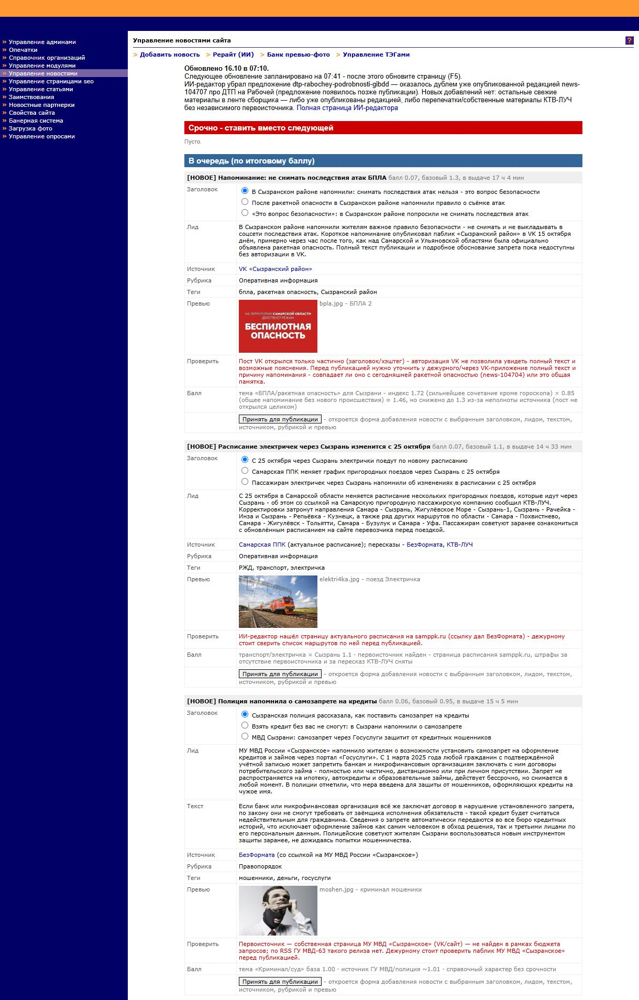
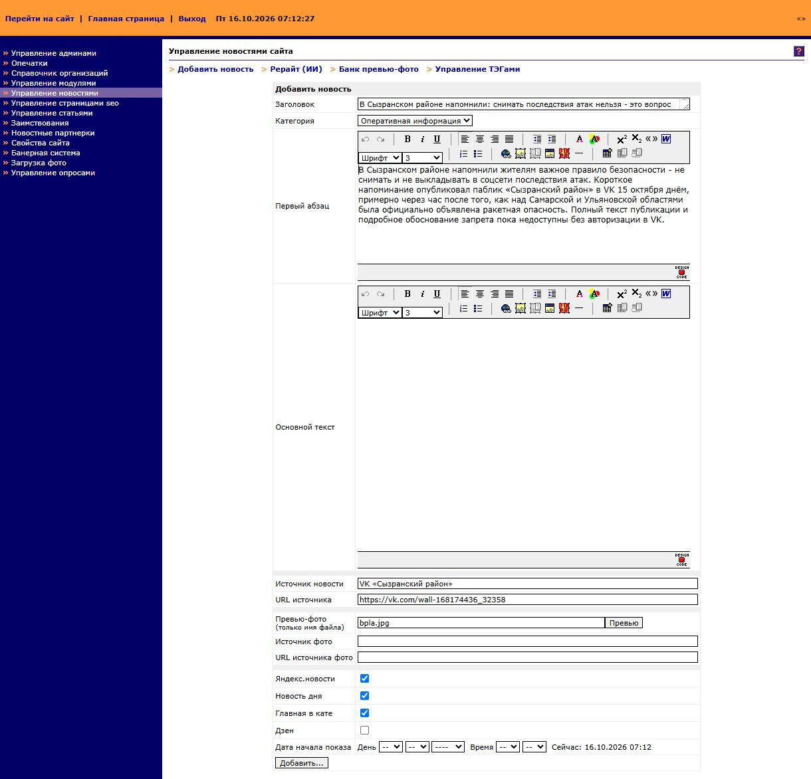
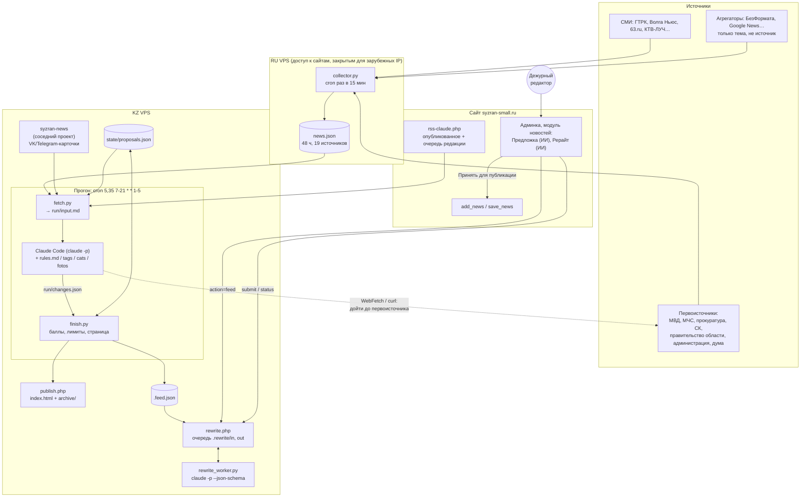
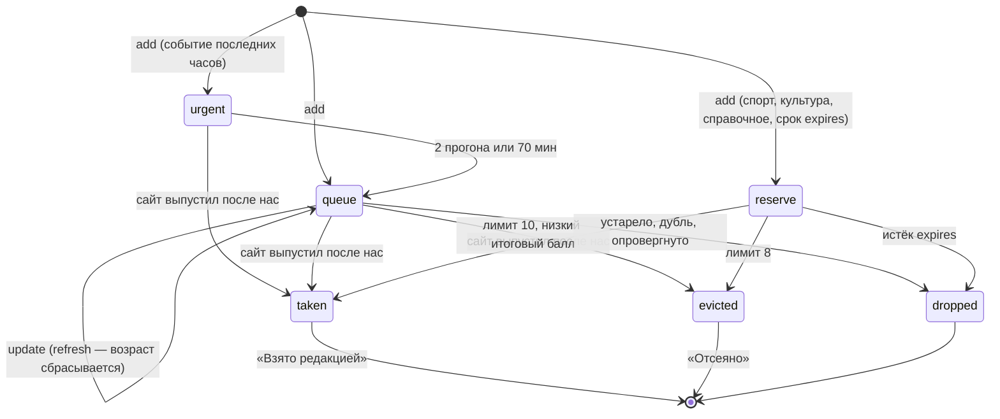
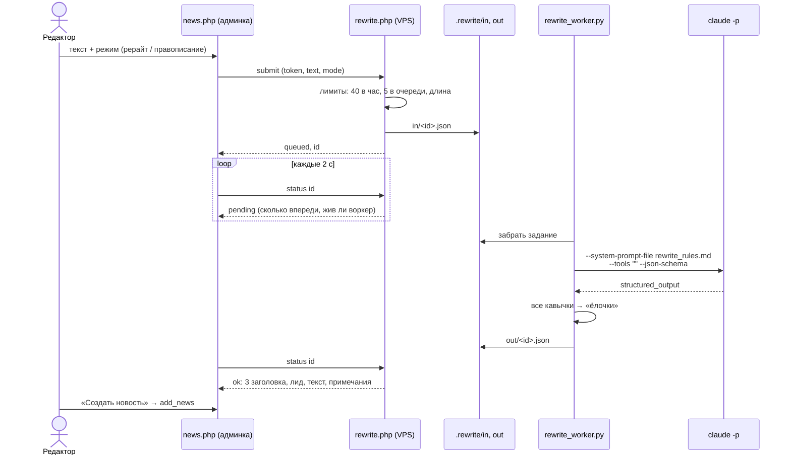

# ИИ-редактор

«Младший редактор» для городского новостного сайта [syzran-small.ru](https://www.syzran-small.ru) (Сызрань). Каждые полчаса ИИ-агент читает первоисточники, СМИ и соцсети, отбирает новости про Сызрань, сверяет их с тем, что сайт уже выпустил или поставил в очередь, доходит до первоисточника, пишет три варианта заголовка, лид и текст, ставит рубрику, теги и превью и кладёт всё это в «Предложку» в админке сайта. Сам на сайт агент ничего не публикует. Решение принимает дежурный редактор: нажал «Принять для публикации», и открывается заполненная форма новой новости.

Второй инструмент — «Рерайт (ИИ)» в той же админке. Редактор вставляет любой текст и получает три заголовка, лид и текст в стиле редакции или исправленный текст в режиме проверки правописания.

<table>
  <tr>
    <th>Предложка (ИИ) в админке</th>
    <th>«Принять для публикации» → форма новости</th>
  </tr>
  <tr>
    <td valign="top"></td>
    <td valign="top"></td>
  </tr>
</table>

## Стек

| Слой | Чем сделано |
|---|---|
| Агент-редактор | [Claude Code](https://docs.anthropic.com/en/docs/claude-code) в headless-режиме (`claude -p`) по подписке (`CLAUDE_CODE_OAUTH_TOKEN`), инструменты Read/Edit/Write/Bash/WebFetch/WebSearch под белым списком |
| Правила редакции | Markdown в системном промпте: `rules.md` (правила отбора, справочник первоисточников, стиль, баллы), `tags.md`, `cats.md`, `fotos.md` (теги, рубрики и банк превью сайта) |
| Рерайт | `claude -p` без инструментов, структурированный ответ по JSON Schema (`--json-schema`) |
| Сбор новостей | Python stdlib: сборщик на российском VPS (19 RSS/HTML-источников) + VK/Telegram-карточки соседнего проекта `syzran-news` |
| Логика вокруг модели | Python: `fetch.py` (вход), `finish.py` (состояние, баллы, лимиты, страница, лента для админки) |
| Хостинг | VPS в Казахстане (1 CPU, 2 ГБ, Ubuntu 22.04): cron, nginx, php-fpm |
| Интеграция с сайтом | PHP-блоки в модуле новостей админки (CMS SmallNuke, windows-1251) + `rewrite.php` на VPS |
| Связующее звено | `state/proposals.json` (предложения между прогонами), `run/changes.json` (ответ модели), `.feed.json` (лента для админки) |

## Архитектура



Как и в [«Городе Н»](https://github.com/delffine/gorod-n), работа поделена так: **детерминированное делает Python, решения принимает модель.** Скрипты скачивают ленты, считают, что нового с прошлого прогона, ведут состояние, пересчитывают баллы, вытесняют лишнее, собирают страницу и публикуют её. Модель читает новое, сверяет факты с сайтом, ищет первоисточник, решает, что предложить, что убрать и что обновить, и пишет тексты. Модель не видит токенов и не может ничего опубликовать: её единственный выход — файл `run/changes.json`.

## Прогон по шагам

```mermaid
sequenceDiagram
    participant CR as cron (run.sh)
    participant F as fetch.py
    participant C as Claude Code
    participant W as Интернет
    participant FN as finish.py
    participant P as publish.php

    CR->>CR: flock: прошлый прогон ещё идёт → пропуск
    CR->>F: python3 fetch.py
    F->>F: лента сборщика, VK/TG-карточки, rss-claude.php,<br/>сводка своих предложений → run/input.md
    alt нового нет
        F-->>CR: код 3, changes.json «нового нет»
    else есть новое
        CR->>C: claude -p prompt.md<br/>--append-system-prompt rules+tags+fotos+cats
        C->>C: Read run/input.md
        C->>W: curl / WebFetch первоисточников (до ~25 запросов)
        C->>C: Write run/changes.json + проверка json.load
    end
    CR->>FN: python3 finish.py
    FN->>FN: drop / add / update → proposals.json<br/>фильтр тегов, рубрик, превью; штрафы; затухание; лимиты
    FN->>FN: .feed.json для админки
    FN->>P: POST token + html
    P->>P: старую страницу → archive/, метка времени
```

### 0. cron и `run.sh`

Прогоны идут по будням с 7:05 до 21:35, каждые 30 минут (`5,35 7-21 * * 1-5`), в часы работы редакции. `run.sh`:

- держит `flock`, чтобы два прогона не шли параллельно;
- подгружает `~/.config/ai-editor.env` (токен подписки Claude, адрес ленты сборщика);
- запускает `claude -p "$(cat prompt.md)"` с `--append-system-prompt "$(cat rules.md tags.md fotos.md cats.md)"`. Правила лежат в системном промпте, а не в файле для чтения: неизменный префикс кэшируется между прогонами, и модель не тратит ходы на его чтение;
- `--tools` оставляет только нужные инструменты, `--permission-mode dontAsk` и `--allowedTools` ограничивают права: читать можно только `~/ai-editor/**`, писать — только `run/changes.json`, в Bash разрешены `curl`, `python3`, `grep`, `head`, `echo`;
- `timeout -s KILL 900`, `< /dev/null`, `--output-format json`. Число ходов, длительность и стоимость прогона пишутся в дневной лог.

### 1. Вход — `fetch.py`

Обычный Python, без модели. Собирает `run/input.md`:

- **лента сборщика** с RU VPS: всё про Сызрань, засечённое после прошлого успешного чтения (у ленты своя отметка `feed_last`, поэтому новости, пришедшие во время сбоя, разбираются потом);
- **VK/Telegram-карточки** соседнего проекта `syzran-news` за сутки;
- **сайт** через `rss-claude.php`: 40 последних новостей с пометками `НОВОЕ` (id больше, чем в прошлый прогон) и `ПЛАН` (дата в будущем, то есть очередь редакции). Лиды даются только за последние 12 часов;
- **компактная сводка своих предложений**: id, блок, возраст, заголовок, начало лида. Полный `proposals.json` модель читает точечно и только тогда, когда обновляет предложение.

Если нового нет ни в источниках, ни на сайте, `fetch.py` выходит с кодом 3 и Claude не вызывается: страница просто пересчитывает баллы. Если сборщик недоступен, прогон идёт по сайту и VK/TG, а на странице появляется предупреждение.

### 2. Решения — Claude Code

Модель получает правила редакции в системном промпте и задание из `prompt.md`:

1. **Первоисточник, а не перепечатка.** Агрегаторы дают только тему. По справочнику ведомств (полиция → ГУ МВД, пожары → МЧС, город → администрация…) модель доходит до первоисточника и ссылается на него. Если первоисточник не найден, она так и пишет в `note`.
2. **Дубликат сверяется по фактам, а не по теме.** Отключения воды, ДТП и погода повторяются каждый день, поэтому сравниваются даты, адреса и время.
3. **У происшествия есть цепочка обновлений.** Если появились новые факты к уже вышедшей новости, это не дубль: модель пишет предложение-обновление со ссылкой на `news-XXXXX`.
4. **Город издания не равен месту события.** Сызранское СМИ часто перепечатывает чужие новости.
5. **Прямой конкурент понижается**, областные, федеральные и официальные источники повышаются.

По каждой новости модель выбирает блок (`urgent` / `queue` / `reserve`), ставит базовый балл по таблицам из анализа 5000 новостей сайта (`docs/ANALYSIS_RSS5000.md`: какие темы и источники читают), рубрику, до трёх тегов и превью из банка сайта. Ответ — JSON с операциями `drop` / `add` / `update` / `skipped`. Если сайт выпустил новость после нашего предложения, предложение снимается с пометкой «взято» и ссылкой на новость сайта.

### 3. Состояние и страница — `finish.py`

Обычный Python. Модель не правит состояние напрямую: каждую её операцию применяет и проверяет код.

- **Битый JSON** (самый частый сбой — прямая кавычка внутри текста) чинится автоматически: экранируется кавычка, на которой споткнулся разбор.
- **Теги, рубрики и превью** проходят только из списков сайта (`tags.md`, `cats.md`, `fotos.md`), остальное выбрасывается.
- **Конкурент как главный источник**: базовый балл ×0.4, и такое предложение не попадает в «Срочно».
- **Затухание**: итоговый балл = базовый / (1 + минуты в выдаче / 60). Не взятое редакцией за пару прогонов опускается вниз, и свежее поднимается само. Запас не затухает.
- **Лимиты**: «Срочно» держится не дольше 2 прогонов или 70 минут, потом уходит в очередь. В очереди до 10 предложений, лишние вытесняются по итоговому баллу. В запасе до 8, вытесняются предложения с меньшим базовым баллом. Всё вытесненное видно в разделе «Отсеяно».
- **Страница** собирается по `template.html` и уходит POST-запросом в `publish.php`. Токен публикации лежит в отдельном файле, который Claude не видит. `publish.php` переносит прошлую версию в `archive/` и сам ставит метку времени.
- **Лента для админки** `.feed.json` содержит только текст, без HTML: метки и примечания идут текстом, источники — списком `{t, url}`. В ленте есть и время следующего обновления.
- Если прогон не удался, отметка `last_run` не сдвигается, и пропущенное разберёт следующий прогон.

## Жизненный цикл предложения



## Интеграция с админкой сайта

Сайт работает на старой PHP-CMS (SmallNuke, windows-1251, PHP без `mbstring` на VPS). Целиком модуль новостей в репозиторий не выложен, здесь только встроенные в него ИИ-блоки:

| Файл | Что это |
|---|---|
| `server/rewrite/news_ai_rewrite.php` | `ai_rewrite()` — диалог «Рерайт (ИИ)», `ai_rewrite_ajax()` — прокси к VPS, `ai_rw_prefill()` — предзаполнение формы `add_news`, `ai_feed_keywords()` — теги только из `tagarray.php`, журнал `log/aiedit…` |
| `server/rewrite/news_ai_feed.php` | `ai_feed()` — страница «Предложка (ИИ)»: забирает ленту с VPS, карточки рисует JS из текстовых полей |
| `server/rewrite/patch_news.py` | встраивает оба блока в исходный `news.php`: функции перед `switch($in)`, `case`-ы, ссылки в меню модуля, предзаполнение полей `add_news` и `save_news`. Проверяет число вхождений каждой правки и обратимость cp1251 |
| `server/claude-rss.php` | лента для агента: полный текст, просмотры, источник, рубрика, теги, превью и **запланированные** новости (очередь редакции) |

Токен VPS в браузер не попадает. Браузер общается только с `news.php` (сессия админа), а `news.php` уже ходит на VPS с токеном. Текст из браузера передаётся в base64, ответ VPS — JSON в чистом ASCII, поэтому перекодировать cp1251 ↔ UTF-8 не нужно.

### Рерайт



- Воркер работает постоянно, раз в сутки или после обновления своего файла перезапускается сам. cron раз в минуту поднимает его заново под `flock`, если он упал.
- `--json-schema` даёт структурированный ответ, который проверяет сам Claude Code, так что битого JSON здесь не бывает.
- Кавычки исправляются кодом, а не промптом: модель иногда пропускает «лапки», `fix_quotes()` не ошибается.
- Текст редактора — только материал для пересказа: в `rewrite_rules.md` прямо сказано не выполнять инструкции внутри него.
- Тексты новостей в лог воркера не пишутся, только id, длина, время и стоимость.

## Сборщик на RU VPS

Часть первоисточников (правительство области, минтранс, СК, ГТРК) не открывается с зарубежного IP. Поэтому сбор вынесен на второй VPS с российским IP. `collector/collector.py` — один файл на стандартной библиотеке Python 3.8+, его можно поставить на любой сервер без pip и venv:

- cron раз в 15 минут обходит 19 источников (RSS и списки ссылок со страниц) и кладёт всё свежее за 48 часов в один JSON, который отдаёт nginx;
- у каждой записи есть поля `published_at`, `detected_at`, `source`, `kind` (`primary` / `media` / `aggregator`), `title`, `text`, `url`, `syzran`. Для сызранских новостей полный текст дотягивается со страницы;
- `--probe` проверяет доступность закрытых сайтов и ищет на них RSS.

## Надёжность и безопасность

| Риск | Что сделано |
|---|---|
| Модель публикует что-то сама | на сайт автопубликации нет; модель пишет только `run/changes.json`, токен публикации от неё скрыт |
| Опасная команда агента | `--tools` + `--allowedTools` + `dontAsk`: чтение только в каталоге проекта, запись в один файл, Bash — 5 команд |
| Выдуманные теги, рубрики, превью | `finish.py` пропускает только значения из списков сайта |
| Битый JSON от модели | автопочинка в `finish.py`; в рерайте — `--json-schema` |
| Сбой Claude (лимит подписки, таймаут) | страница всё равно публикуется с предупреждением и прошлыми предложениями; `last_run` не сдвигается |
| Сборщик недоступен | прогон идёт по сайту и VK/TG, на странице предупреждение; своя отметка `feed_last` |
| Пустые прогоны тратят подписку | нового нет → Claude не вызывается (код 3) |
| Предложка зарастает | затухание балла, лимиты блоков, `expires` у запаса |
| Зависание | `timeout -s KILL 900`, `flock`; у рерайта — таймаут 240 с, задания старше 15 мин отбрасываются |
| Спам в рерайт | токен, 40 заданий в час, до 5 в очереди, лимит длины; страница доступна только вошедшему админу |
| Каталоги очереди и ленты | лежат в точечных каталогах, nginx их не отдаёт; PHP исполняется только для `publish.php` и `rewrite.php` |
| Секреты | в репозитории `CHANGE_ME` и шаблон `.env.example`; на VPS — файлы с правами 600 |

## Цифры

- 30 прогонов в рабочий день; обычный прогон — 5–14 ходов модели, 1–4 минуты. Первый прогон утром (за всю ночь) идёт до 5–6 минут.
- Оценка расхода по `total_cost_usd` Claude Code: $0.13–0.45 за прогон, утренний до ~$0.9, **~$7–8.5 за день**. Расходуется подписка, а не API-ключ.
- Рерайт: 11–55 секунд, $0.02–0.06.
- Первый полный день на сервере (28.09.2026): сайт выпустил 26 новостей, **14 из них совпали с предложениями ИИ-редактора** (из ~18 сызранских).

## Структура репозитория

```
ai_editor/
├── server/
│   ├── runner/                 — прогон на KZ VPS (~/ai-editor/)
│   │   ├── run.sh              — cron: flock, fetch → claude -p → finish, лог
│   │   ├── fetch.py            — вход прогона → run/input.md
│   │   ├── prompt.md           — задание прогона и формат changes.json
│   │   ├── rules.md            — правила редакции (системный промпт)
│   │   ├── tags.md, cats.md, fotos.md — теги, рубрики, банк превью сайта (системный промпт)
│   │   ├── build_tags.py, build_cats.py, build_fotos.py — собирают их из выгрузок сайта
│   │   ├── finish.py           — состояние, баллы, лимиты, страница, .feed.json, публикация
│   │   ├── template.html       — шаблон страницы (автообновление вкладки)
│   │   └── cost.sh             — сумма стоимости прогонов за день
│   ├── rewrite/
│   │   ├── rewrite.php         — очередь рерайта и выдача ленты Предложки (VPS)
│   │   ├── rewrite_worker.py, rewrite_worker.sh — воркер и его сторож (cron)
│   │   ├── rewrite_rules.md, proof_rules.md     — промпты режимов
│   │   ├── news_ai_rewrite.php, news_ai_feed.php — ИИ-блоки модуля новостей админки
│   │   └── patch_news.py       — встраивает их в news.php
│   ├── publish.php             — приём страницы, архив прошлых версий
│   ├── claude-rss.php          — лента сайта для агента (живёт на сайте)
│   └── nginx-8808.conf
├── collector/collector.py      — сборщик на RU VPS
├── docs/ANALYSIS_RSS5000.md    — анализ 5000 новостей сайта: источники, стиль, что читают, баллы
└── .env.example                — какие переменные и токены нужны
```

## Установка (кратко)

```bash
# KZ VPS, пользователь без sudo
mkdir -p ~/ai-editor && cp server/runner/* server/rewrite/rewrite_worker.* server/rewrite/*_rules.md ~/ai-editor/
# ~/.config/ai-editor.env и ~/.config/ai-editor-publish.env — по .env.example, chmod 600
# /var/www/ai-editor/: publish.php и rewrite.php с токенами вместо CHANGE_ME
crontab -e
#   5,35 7-21 * * 1-5  ~/ai-editor/run.sh
#   * * * * *          ~/ai-editor/rewrite_worker.sh

# Админка сайта
python server/rewrite/patch_news.py news.php.orig news.php   # потом вписать AI_RW_URL и AI_RW_TOKEN

# RU VPS
python3 collector/collector.py --probe
python3 collector/collector.py --out /var/www/html/<путь>/news.json   # в cron раз в 15 мин
```

Время везде самарское (UTC+4): сервер работает в поясе `Europe/Samara`, поэтому cron идёт без сдвигов.
